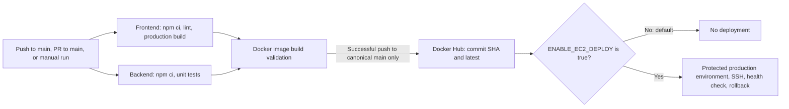

# ReVendo

### Give Good Things a Second Life.

[](https://github.com/varun0981/ReVendo-app/actions/workflows/revendo-ci-cd.yml)

ReVendo is a responsive marketplace for buying and selling pre-loved products. It pairs a React storefront with an Express API and MongoDB, including seller listings, moderation, wishlists, orders, and an admin dashboard.

## Features

- Browse, search, filter, and sort active listings.
- Create listings with multiple images; edit, delete, and track listing status.
- Register and sign in with verified email/mobile flows, secure password hashing, and HTTP-only JWT session cookies.
- Manage profiles, wishlists, carts, orders, notifications, and seller reviews.
- Use demo cash on delivery or optional **Razorpay test mode**. Razorpay test credentials are server-only; no live payment keys or real charges are supported.
- Moderate products, users, orders, and reports through the admin dashboard.

## Technology

| Area | Stack |
| --- | --- |
| Frontend | React, Vite, Tailwind CSS, React Router, Axios, Lucide, React Hot Toast |
| Backend | Node.js, Express, Mongoose, MongoDB, JWT, bcrypt |
| Security | Helmet, rate limits, validation, ownership checks, safe image uploads |

## Requirements

- Node.js 20.19+ or 22.12+
- npm
- MongoDB Community Server

## Quick start

1. Install dependencies from the project root:

   ```bash
   npm install
   npm install --prefix client
   npm install --prefix server
   ```

2. Create the local server configuration:

   ```bash
   cp server/.env.example server/.env
   ```

   Set a private `JWT_SECRET` of at least 32 characters and an `ADMIN_PASSWORD` of 12–72 characters. Keep `server/.env` private and untracked.

3. Start MongoDB. For macOS with Homebrew:

   ```bash
   brew tap mongodb/brew
   brew install mongodb-community
   brew services start mongodb/brew/mongodb-community
   ```

4. Seed sample products and the administrator account:

   ```bash
   npm run seed
   ```

   Sign in to the admin account with the `ADMIN_EMAIL` and `ADMIN_PASSWORD` values from your local `server/.env`.

5. Start the frontend and API:

   ```bash
   npm run dev
   ```

   Open [http://localhost:5173](http://localhost:5173). The API runs at `http://localhost:5051`; check it with `GET /api/health`.

## Docker Compose

Docker Desktop (or Docker Engine) with the Compose plugin is required.

1. Create a root-level Compose environment file and replace the example JWT secret with a random value of at least 32 characters:

   ```bash
   cp .env.example .env
   openssl rand -base64 48
   ```

   The example uses an internal MongoDB container for local testing. The `.env` file is ignored by Git and is not copied into either image. If a secret contains `$`, use single quotes around its value in `.env`.

2. Build and start the complete stack:

   ```bash
   docker compose config --quiet
   docker compose up --build -d
   docker compose ps
   curl --fail http://localhost:8080/api/health
   ```

   Browse to [http://localhost:8080](http://localhost:8080). Nginx serves the React app and proxies `/api` and `/uploads` to the backend. The backend health check gates frontend startup. MongoDB and the backend are not published directly to the host.

3. Optional development data and troubleshooting:

   ```bash
   docker compose exec backend npm run seed
   docker compose exec backend npm run seed:admin
   docker compose logs -f backend frontend
   ```

   Before running `seed:admin`, set a private `ADMIN_EMAIL` and `ADMIN_PASSWORD` (12–72 characters) in `.env`; these are blank in the example. With the default `NODE_ENV=development`, the email verification link appears in backend logs and the simulated phone OTP is `123456`; neither sends real messages. Uploaded product images and the local MongoDB data persist in named Docker volumes. `docker compose down` stops containers but preserves those volumes.

### MongoDB Atlas

To use Atlas instead of the bundled local MongoDB, set `MONGO_URI` in the root `.env` to your `mongodb+srv://` connection string. URL-encode special characters in the database username and password, and allow the Docker host's egress IP in Atlas Network Access. Keep the URI only in `.env`; Compose passes it to the backend at runtime and never builds it into an image. The local MongoDB container remains unexposed and is unused by the backend.

For a production deployment, set `NODE_ENV=production`, use HTTPS at the public edge, configure real mail/SMS delivery as needed, and keep all credentials in a deployment secret manager or an untracked environment file.

## Jenkins CI/CD

The root `Jenkinsfile` checks out the configured SCM, runs frontend lint/build and backend tests, builds both Docker images, and publishes build-number and `latest` tags to Docker Hub from the `main` branch only. Feature branches still run checks and image builds but do not publish. This pipeline does not deploy to EC2.

### Jenkins prerequisites

- Use a **Multibranch Pipeline** job connected to this GitHub repository, with the `main` branch discovered. `checkout scm` uses that job's configured GitHub source; add a GitHub credential to the source only if the repository is private.
- The Jenkins agent needs Node.js 22.12+ with npm, Docker CLI access to a Docker daemon, and network access to npm and Docker Hub.
- Install the Pipeline, GitHub Branch Source, and Credentials Binding plugins. Install/configure the Jenkins Mailer plugin only if email notifications are desired.
- Create the Docker Hub repositories `revendo-frontend` and `revendo-backend` under the publishing account or organization.

### Docker Hub credentials

In **Manage Jenkins → Credentials**, add a **Username with password** credential with ID `revendo-dockerhub`. Use the Docker Hub username for the username and a Docker Hub access token with repository write permission for the password. Do not put the token in the Jenkinsfile, repository, build parameters, or README. By default, images are pushed under the credential's username. To publish under an organization, set the non-secret Jenkins environment variable `DOCKERHUB_NAMESPACE` to that organization name.

The `main` branch publishes both `BUILD_NUMBER` and `latest` tags. The push stage uses an isolated temporary Docker credential directory and removes it after pushing. Jenkins agents that build untrusted pull requests should not have Docker Hub credentials available to those jobs.

If GitHub Actions is the selected image publisher, disable Jenkins' Docker Hub push stage before enabling the Actions publisher. Both pipelines otherwise update the same `latest` tags.

### Optional email notifications

Configure SMTP in Jenkins' Mailer settings and set the non-secret `NOTIFICATION_EMAIL` environment variable on the job or folder. When it is unset, the pipeline skips email and records that choice in the build log.

## GitHub Actions CI/CD

The [ReVendo CI/CD workflow](.github/workflows/revendo-ci-cd.yml) runs on pushes to `main`, pull requests targeting `main`, and manual `workflow_dispatch`. A forked pull request can run checks and Docker builds, but never receives Docker Hub or deployment credentials. The badge above reports the live GitHub Actions status; local validation is not a GitHub Actions run.



### Workflow stages and monitoring

1. **Frontend** installs from `client/package-lock.json`, runs `npm run lint`, and creates the Vite production build.
2. **Backend** installs from `server/package-lock.json` and runs `npm test`. The current Node test suite uses mocked gateway calls and does not require MongoDB or production database credentials.
3. **Docker build validation** builds both existing Dockerfiles for `linux/amd64` and `linux/arm64` on pushes, pull requests, and manual runs without authenticating or publishing.
4. **Docker Hub push** runs only after all checks pass on a push to this repository's `main` branch. It publishes multi-platform images tagged with the full commit SHA and `latest`.
5. **EC2 deployment** depends on the successful image push and is disabled unless the repository variable `ENABLE_EC2_DEPLOY` is set to the exact string `true`.

Open the repository's **Actions** tab to monitor runs, inspect job logs, cancel a run, or choose **ReVendo CI/CD → Run workflow** for a manual CI/build-only run. Manual runs do not publish images or deploy.

### GitHub Actions secrets and Docker Hub images

Add these repository secrets under **Settings → Secrets and variables → Actions** before merging the workflow to `main`:

| Secret | Purpose |
| --- | --- |
| `DOCKERHUB_USERNAME` | Docker Hub account username (`varun0981`) |
| `DOCKERHUB_TOKEN` | Docker Hub access token with write access to the two image repositories |

Ensure GitHub Actions is enabled for the repository, then push this workflow to `main` or merge a pull request containing it. The `main` push will run CI and attempt the Docker Hub publish; add both secrets first so that stage can authenticate.

The published images are `varun0981/revendo-frontend:<commit-sha>` and `varun0981/revendo-backend:<commit-sha>`, with `latest` also updated on successful `main` pushes. Each tag supports `linux/amd64` and `linux/arm64`. Keep both Docker Hub repositories available to the publisher. For EC2 pulls, make them public or separately configure a read-only pull credential on the instance; never reuse the CI push token there.

### Future EC2 deployment (disabled)

No EC2 deployment is performed by default. To prepare it, create a protected GitHub Environment named `production`, configure required reviewers, and add these **environment secrets**:

| Secret | Purpose |
| --- | --- |
| `EC2_HOST` | User-provided EC2 public DNS name or IPv4 address |
| `EC2_USER` | SSH account configured on that instance |
| `EC2_SSH_PRIVATE_KEY` | Private key authorized for that account |
| `EC2_KNOWN_HOSTS` | Verified SSH host-key line(s); do not disable host-key checking |
| `PRODUCTION_MONGO_URI` | Production MongoDB/Atlas connection URI |
| `PRODUCTION_JWT_SECRET` | Private session-signing value of at least 32 characters |
| `PRODUCTION_SMTP_HOST`, `PRODUCTION_SMTP_USER`, `PRODUCTION_SMTP_PASSWORD` | Mail delivery required for production email verification |
| `PRODUCTION_TWILIO_ACCOUNT_SID`, `PRODUCTION_TWILIO_AUTH_TOKEN`, `PRODUCTION_TWILIO_FROM_NUMBER` | Optional real SMS delivery settings |

Set these non-secret repository variables: `ENABLE_EC2_DEPLOY` (leave unset or `false` until explicitly ready), `EC2_DEPLOY_PATH` (safe absolute path on the instance), `PRODUCTION_CLIENT_URL` (public HTTPS origin), and optionally `EC2_SSH_PORT`, `PRODUCTION_SMTP_PORT`, `PRODUCTION_SMTP_SECURE`, and `PRODUCTION_EMAIL_FROM`. The production Compose file uses the SHA-pinned images and a persistent uploads volume; it expects MongoDB to be provided externally.

The deploy job uses pinned `known_hosts` data and strict SSH host-key checking. It writes the runtime `.env` on the instance with restrictive permissions, waits for Docker health checks, and probes the API through Nginx. On failure it restores the prior Compose configuration and environment and attempts to bring the previous SHA-tagged release back up. Keep prior SHA images in Docker Hub; an initial deployment has no prior release to roll back to.

This SSH path does **not** need AWS access keys or an AWS secret key, and none are supplied or invented. Restrict SSH network access to a trusted runner; a self-hosted runner in the VPC or a later SSM/OIDC design is preferable to opening SSH broadly. Terminate TLS in a configured load balancer or reverse proxy and allow the app's port `8080` only from that proxy. Do not set `ENABLE_EC2_DEPLOY=true` until the host, SSH trust, production database, HTTPS origin, required email delivery, and environment approvals are configured.

## Local verification modes

- **Email:** without SMTP settings, verification uses a development link printed by the server. No email is sent.
- **Mobile:** without Twilio settings, development OTP is `123456`. No SMS is sent.
- **Razorpay:** add a test key ID (`rzp_test_...`) and its test secret to `server/.env` as `RAZORPAY_KEY_ID` and `RAZORPAY_KEY_SECRET`, then restart the API. Only `rzp_test_` keys are accepted, and the secret is never returned to the frontend. Razorpay checkout requires an internet connection.
- **Cash on delivery:** remains available as a local demo option and does not process a payment.

## Commands

| Command | Description |
| --- | --- |
| `npm run dev` | Run the frontend and API |
| `npm run dev:client` / `npm run dev:server` | Run one service |
| `npm run build` | Build the frontend |
| `npm run lint` | Lint frontend source |
| `npm test --prefix server` | Run backend tests |
| `npm run seed` | Seed products and the administrator |
| `npm run seed:products` / `npm run seed:admin` | Seed either separately |

## Project layout

```text
client/   React application, pages, components, and browser API client
server/   Express routes, controllers, models, middleware, services, and tests
```

The Vite development server proxies `/api` and `/uploads` to port `5051`. If you change the API port, set `PORT` and `VITE_API_PROXY_TARGET` consistently.

## Security and local data

- Secrets belong in local environment files, never in frontend variables or source control. `server/.env.example` contains placeholders only.
- Uploaded listing images are stored under `server/uploads/` and are excluded from Git.
- The default MongoDB URI is `mongodb://127.0.0.1:27017/revendo`; configure another local URI with `MONGO_URI`.
- Never use live payment credentials with this project.

## Troubleshooting

- **MongoDB connection error:** start MongoDB and check `MONGO_URI` in `server/.env`.
- **API startup error:** confirm `server/.env` exists, `JWT_SECRET` is set, and port `5051` is available.
- **Razorpay checkout unavailable:** configure both Razorpay test variables in `server/.env` and restart the API. Without them, demo cash on delivery remains usable.
- **Missing dependencies:** run the three install commands in Quick start.
